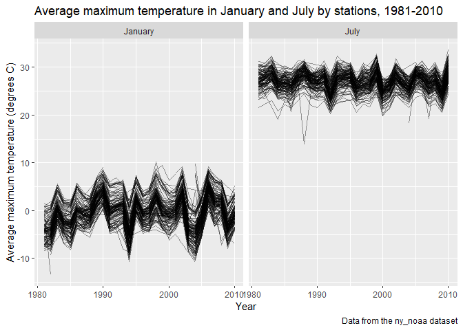
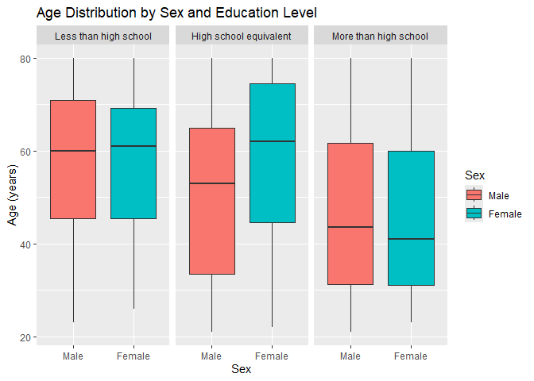

p8105_hw3_xc2859
================
Xiaoxue Cui
2026-10-16

``` r
library(tidyverse)
```

    ## ── Attaching core tidyverse packages ──────────────────────── tidyverse 2.0.0 ──
    ## ✔ dplyr     1.2.1     ✔ readr     2.2.0
    ## ✔ forcats   1.0.1     ✔ stringr   1.6.0
    ## ✔ ggplot2   4.0.3     ✔ tibble    3.3.1
    ## ✔ lubridate 1.9.5     ✔ tidyr     1.3.2
    ## ✔ purrr     1.2.2     
    ## ── Conflicts ────────────────────────────────────────── tidyverse_conflicts() ──
    ## ✖ dplyr::filter() masks stats::filter()
    ## ✖ dplyr::lag()    masks stats::lag()
    ## ℹ Use the conflicted package (<http://conflicted.r-lib.org/>) to force all conflicts to become errors

``` r
library(patchwork)
library(p8105.datasets)
library(hexbin)
library(ggridges)
```

# Problem 1

**Load dataset**

Firstly, we load the packages and the dataset for setup.

``` r
# load NY NOAA dataset
data("ny_noaa")

# In order to assess which data might be an issue, we need to calculate the proportion of missing data for each variable. 
ny_noaa |> 
  summarize(
    across(everything(), ~mean(is.na(.x))) * 100
  )
```

    ## # A tibble: 1 × 7
    ##      id  date  prcp  snow  snwd  tmax  tmin
    ##   <dbl> <dbl> <dbl> <dbl> <dbl> <dbl> <dbl>
    ## 1     0     0  5.62  14.7  22.8  43.7  43.7

**Dataset description**

The `ny_noaa` dataset contains 2595176 observations and 7 variables. The
observations were collected from 747 weather stations between date of
1981-01-01 and date of 2010-12-31. Each observation represents
measurements of weather condition from one weather station on a specific
date. The variables included in the dataset are station id, date,
precipitation, snowfall, snow depth, and daily maximum and minimum
temperatures. The proportion of missing data for variables station id,
precipitation, snowfall, snow depth, daily maximum temperatures and
daily minimum temperatures is 0%, 0%, 5.62%, 14.69%, 22.80%, 43.71% and
43.71%, respectively. Based on this, missing data is a large issue in
this dataset, especially for daily maximum and minimum temperatures.
There is also moderate missingness for snowfall (14.69% missing) and
snow depth (22.80% missing), whereas missing data issue is mild for
precipitation.

**Data cleaning and answer questions**

For data cleaning, I first standardized the variable names. Then, I
separated the `date` variable into 3 different variables `year`, `month`
and `day`. In the original dataset, the units of temperatures and
precipitation are in tenths of degrees Celsius (C) and tenths of
millimeters (mm), respectively. I converted the unit of precipitation to
mm and the unit of temperatures to degrees C.

``` r
# Clean the dataset
library(lubridate) # I found this packages and functions for separating year, month and day on the Internet. 
noaa_cleaned_df = 
  ny_noaa |> 
  janitor::clean_names() |> 
  mutate(
    year = year(date), 
    month = month(date), 
    day = day(date), 
    prcp = prcp / 10, 
    tmax = as.numeric(tmax) / 10, 
    tmin = as.numeric(tmin) / 10
  )

# For snowfall, what are the most commonly observed values? 
noaa_cleaned_df |> 
  filter(!is.na(snow)) |> 
  count(snow, sort = TRUE)
```

    ## # A tibble: 281 × 2
    ##     snow       n
    ##    <int>   <int>
    ##  1     0 2008508
    ##  2    25   31022
    ##  3    13   23095
    ##  4    51   18274
    ##  5    76   10173
    ##  6     8    9962
    ##  7     5    9748
    ##  8    38    9197
    ##  9     3    8790
    ## 10   102    6552
    ## # ℹ 271 more rows

0 mm is the most commonly observed value. This is because most days are
not in winter and don’t have snowfall. Other common values are 13 mm, 25
mm, 51 mm, and 76 mm. These values are likely the result of converting
from inches to millimeters. If converting these values to inches, we can
get approximately 0.5 inches, 1 inch, 2 inches, and 3 inches,
respectively.

``` r
# Get the average max temperature in January and in July in each station across years
noaa_cleaned_df |>
  filter(
    month == 1 | month == 7, 
    !is.na(tmax)
  ) |>
  mutate(
    month = case_match(
      month, 
      1 ~ "January", 
      7 ~ "July"
    )
  ) |> 
  group_by(id, year, month) |> 
  summarize(
    mean_tmax = mean(tmax), 
  ) |> 
  ggplot(aes(x = year, y = mean_tmax, group = id)) + 
  geom_line(alpha = 0.4) + 
  facet_grid(. ~ month) + 
  labs(
    title = "Average maximum temperature in January and July by stations, 1981-2010", 
    x = "Year", 
    y = "Average maximum temperature (degrees C)", 
    caption = "Data from the ny_noaa dataset"
  )
```

    ## Warning: There was 1 warning in `mutate()`.
    ## ℹ In argument: `month = case_match(month, 1 ~ "January", 7 ~ "July")`.
    ## Caused by warning:
    ## ! `case_match()` was deprecated in dplyr 1.2.0.
    ## ℹ Please use `recode_values()` instead.

    ## `summarise()` has regrouped the output.
    ## ℹ Summaries were computed grouped by id, year, and month.
    ## ℹ Output is grouped by id and year.
    ## ℹ Use `summarise(.groups = "drop_last")` to silence this message.
    ## ℹ Use `summarise(.by = c(id, year, month))` for per-operation grouping
    ##   (`?dplyr::dplyr_by`) instead.

<!-- -->

Observable / interpretable structure:

Based on the plots, there is a seasonal difference in average maximum
temperatures, which is that temperatures in July are much higher than in
January. Temperatures in January ranging from -10 to 10 degrees C also
have greater fluctuation of average maximum temperatures than
temperatures in July ranging from 20-35 degrees C. Most weather stations
capture similar annual patterns, but there are a few outliers. For
example, the lowest average maximum temperature in July was around 14
degrees C in the late 1980s; the lowest average maximum temperature in
January was around -13 degrees C in the early 1980s.

``` r
# Create temperature plot for tmax vs tmin
temperature_plot = 
  noaa_cleaned_df |>
  filter(
    !is.na(tmax), 
    !is.na(tmin)
  ) |> 
  ggplot(aes(x = tmin, y = tmax)) + 
  geom_hex() + 
  labs(
    title = "Temperature plot",
    x = "Minimum daily temperature (degrees C)", 
    y = "Maximum daily temperature (degrees C)"
  )

# Create snowfall distribution plot by year
snowfall_plot = 
  noaa_cleaned_df |> 
  filter(
    snow > 0, 
    snow < 100
  ) |> 
  mutate(year = factor(year)) |> 
  ggplot(aes(x = snow, y = year)) + 
  geom_density_ridges(
    scale = 1, 
    alpha = 0.7, 
    fill = "skyblue", 
    color = "white"
  ) + 
  labs(
    title = "Snowfall distribution by year",
    x = "Snowfall (mm)",
    y = "Year",
    caption = "Data from the ny_noaa dataset"
  )

# Combine the two plots into a two-panel plot
temperature_plot + snowfall_plot
```

    ## Picking joint bandwidth of 3.76

<!-- -->

Comments on plots:

1)  Temperature plot: There is an obvious positive relationship between
    daily minimum and maximum temperatures. Days with higher minimum
    daily temperatures also tend to have higher maximum temperatures.
    Some observations fall outside the main patterns. Some combinations
    even show a minimum temperature higher than the maximum, which may
    indicate errors in the records.

2)  Distribution of snowfall by year plot: The distributions of snowfall
    are quite similar across years and do not show major changes in the
    long term. Most snowfall values are concentrated below 40 mm, and
    peaks occur repeatedly around approximately 13, 25, 51, and 76 mm
    across many years. This is consistent with the observation of common
    values in the previous question, which indicates that the snowfall
    values may be converted from inches to millimeters.

# Problem 2

**Load, clean and merge the datasets**

``` r
# Load and clean demographic data
nhanes_covar_df = 
  read_csv("data/nhanes_covar.csv", skip = 4) |>
  janitor::clean_names() |> 
  filter(age >= 21) |> 
  drop_na() |> 
  mutate(
    sex = factor(
      case_match(
        sex, 
        1 ~ "Male", 
        2 ~ "Female"
      ), 
      levels = c("Male", "Female")
    ), 
    education = factor(
      case_match(
        education, 
        1 ~ "Less than high school", 
        2 ~ "High school equivalent", 
        3 ~ "More than high school"
      ), 
      levels = c(
        "Less than high school",
        "High school equivalent",
        "More than high school"
      )
    )
  )
```

    ## Rows: 250 Columns: 5
    ## ── Column specification ────────────────────────────────────────────────────────
    ## Delimiter: ","
    ## dbl (5): SEQN, sex, age, BMI, education
    ## 
    ## ℹ Use `spec()` to retrieve the full column specification for this data.
    ## ℹ Specify the column types or set `show_col_types = FALSE` to quiet this message.

``` r
# Load accelerometer data
nhanes_accel_df = 
  read_csv("data/nhanes_accel.csv") |> 
  janitor::clean_names() |> 
  pivot_longer(
    min1:min1440, 
    names_to = "minute", 
    names_prefix = "min", 
    values_to = "mims"
  ) |> 
  mutate(
    minute = as.numeric(minute)
  )
```

    ## Rows: 250 Columns: 1441
    ## ── Column specification ────────────────────────────────────────────────────────
    ## Delimiter: ","
    ## dbl (1441): SEQN, min1, min2, min3, min4, min5, min6, min7, min8, min9, min1...
    ## 
    ## ℹ Use `spec()` to retrieve the full column specification for this data.
    ## ℹ Specify the column types or set `show_col_types = FALSE` to quiet this message.

``` r
# Merge two datasets
nhanes_merged_df = 
  inner_join(
    nhanes_covar_df, 
    nhanes_accel_df, 
    by = "seqn"
  )
```

The demographic data requires more data cleaning steps. After loading
the demographic data, I firstly cleaned it by standardizing variable
names followed by filtering and retaining participants aged 21 or above.
Then, observations with missing data were dropped. The numeric codes for
sex and education were then converted to categorical factors and ordered
as `Male` / `Female` for sex and `Less than high school` /
`High school equivalent` / `More than high school` for education. I then
loaded the accelerometer data and cleaned the variable names. The
accelerometer data were then tidied by reshaping the `min1`-`min1440`
variables into long format, creating separate `minute`and `mims`
variables, and converting `minute` to numeric. Finally, I merged the two
datasets by participant ID, `seqn`, using the `inner_join()` function.

**Table and visualization**

``` r
# Produce a reader-friendly table for the number of men and women in each education category
nhanes_merged_df |> 
  distinct(seqn, education, sex) |> 
  group_by(education, sex) |>
  summarize(count = n()) |>
  pivot_wider(
    names_from = sex,
    values_from = count
  ) |>
  knitr::kable()
```

    ## `summarise()` has regrouped the output.
    ## ℹ Summaries were computed grouped by education and sex.
    ## ℹ Output is grouped by education.
    ## ℹ Use `summarise(.groups = "drop_last")` to silence this message.
    ## ℹ Use `summarise(.by = c(education, sex))` for per-operation grouping
    ##   (`?dplyr::dplyr_by`) instead.

| education              | Male | Female |
|:-----------------------|-----:|-------:|
| Less than high school  |   27 |     28 |
| High school equivalent |   35 |     23 |
| More than high school  |   56 |     59 |

Comment: The more than high school group had the largest number of
participants, while the less than high school group had the fewest
participants. The numbers of men and women were similar in these two
education categories, but the high school equivalent group included more
men than women.

``` r
# Create a visualization of the age distributions for men and women in each education category
nhanes_merged_df |> 
  distinct(seqn, sex, age, education) |>
  ggplot(aes(x = sex, y = age)) +
  geom_boxplot(aes(fill = sex)) +
  facet_grid(. ~ education) +
  labs(
    title = "Age Distribution by Sex and Education Level",
    x = "Sex",
    y = "Age (years)",
    fill = "Sex"
  )
```

<!-- -->

Comment: Age distribution is different across education levels. Among
participants with less than a high school education, the median ages of
men and women are similar, both around 60 years old. In the high school
equivalent group, women generally have higher age than men, and their
median age is also higher than men. Participants with more than a high
school education are relatively younger, with median ages in the early
40s for both men and women. There are no obvious outliers.
